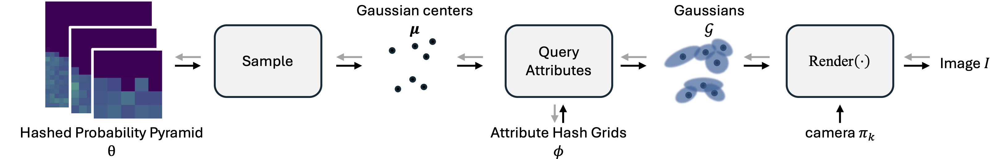

# **Eulerian Splatting using Hashed Probability Pyramids**



Official implementation for the paper **Eulerian Splatting using Hashed Probability Pyramids**. 

[](https://arxiv.org/abs/0000.00000)
[](https://euleriansplatting.github.io)

**Mia Gaia Polansky**, [**George Kopanas**](https://grgkopanas.github.io), [**Stephan Garbin**](http://stephangarbin.com), [**Todd Zickler**](https://zickler.seas.harvard.edu), [**Dor Verbin**](https://dorverbin.github.io)

> *We introduce a probabilistic splat-based radiance field framework that replaces the heuristic densification of 3D Gaussian Splatting with end-to-end gradient-based optimization of a volumetric probability density. By modeling primitive locations as samples from a memory-efficient hierarchical grid, our method allows probability mass to naturally flow to areas with high loss. Stabilized by a novel unbiased gradient estimator, this approach eliminates brittle priors to achieve state-of-the-art PSNR on mip-NeRF 360 while maintaining real-time rendering speeds.*

<hr style="height:3px; background-color:#bdbdbd; border:none;">

## BibTeX
<hr style="height: 1px; background-color:#bdbdbd; border: none; margin-top: -20px; margin-bottom: 5px;">

```bibtex
@inproceedings{polansky2026eulerian,
  title={Eulerian Splatting using Hashed Probability Pyramids},
  author={Polansky, Mia Gaia and Kopanas, George and Garbin, Stephan and Zickler, Todd and Verbin, Dor},
  booktitle={Proceedings of the IEEE/CVF Conference on Computer Vision and Pattern Recognition (CVPR)},
  year={2026}
}
```

<hr style="height:3px; background-color:#bdbdbd; border:none;">

## Installation
<hr style="height: 1px; background-color:#bdbdbd; border: none; margin-top: -20px; margin-bottom: 5px;">

> **This fork (EEL5406 group project) replaces the upstream conda setup with a uv project** so it runs on Blackwell GPUs (B200, RTX PRO 6000): Python 3.10, PyTorch 2.7.1 + CUDA 12.8. Linux x86_64 with an NVIDIA GPU only. The paper used Python 3.9, PyTorch 2.4.1 and CUDA 12.1 on an H200 (see upstream's README).

#### 1. Clone the repository with its submodules
```bash
git clone --recursive https://github.com/Herschenglime/eulerian-splatting.git
cd eulerian-splatting
```
In an existing clone, run `git submodule update --init --recursive`.

#### 2. A CUDA 12.8 toolkit with `nvcc` on `PATH`
`uv sync` compiles tiny-cuda-nn, and the Slang rasterizer and sampling kernel are compiled on first use, so `nvcc` has to be on `PATH` for both. pip has no CUDA 12 `nvcc`; see `docs/colmap-setup.md` for why this isn't a uv dependency.

- **HiPerGator:** `module load cuda/12.8.1`
- **Ubuntu 24.04 workstation:** use NVIDIA's network repository ([12.8.1 install guide, "Network Repo Installation for Ubuntu"](https://docs.nvidia.com/cuda/archive/12.8.1/cuda-installation-guide-linux/index.html#network-repo-installation-for-ubuntu)). Install the versioned `cuda-toolkit-12-8`, not the guide's unversioned `cuda-toolkit`, which installs the newest CUDA. The toolkit package doesn't touch an installed NVIDIA driver. Ubuntu's own `nvidia-cuda-toolkit` package is 12.0, which is too old.
  ```bash
  wget https://developer.download.nvidia.com/compute/cuda/repos/ubuntu2404/x86_64/cuda-keyring_1.1-1_all.deb
  sudo dpkg -i cuda-keyring_1.1-1_all.deb
  sudo apt-get update
  sudo apt-get install cuda-toolkit-12-8
  ```
  Then add `export PATH=/usr/local/cuda-12.8/bin${PATH:+:${PATH}}` to your shell profile ([post-install environment setup](https://docs.nvidia.com/cuda/archive/12.8.1/cuda-installation-guide-linux/index.html#environment-setup)).

Check that `nvcc --version` reports release 12.8.

#### 3. Install everything with uv
```bash
uv sync
```
This installs PyTorch, builds tiny-cuda-nn for RTX 30xx/40xx, L4, B200 and RTX PRO 6000 (a few minutes the first time, then cached), and installs the Slang rasterizer and COLMAP (pycolmap). Run scripts through uv: `uv run python train.py ...`. If you add a GPU type, add its compute capability to `TCNN_CUDA_ARCHITECTURES` in `pyproject.toml`.

#### 4. Check the GPU paths
```bash
uv run pytest                                    # CPU tests
scripts/gpu_smoke_test.sh /path/to/tandt/truck   # ~15 min, sized for a 12 GB card
```
For our own captures, `uv run python scripts/run_colmap.py <photos or video> data/<scene>` builds the dataset (see `CLAUDE.md`).

<hr style="height:3px; background-color:#bdbdbd; border:none;">

## Training & Evaluation
<hr style="height: 1px; background-color:#bdbdbd; border: none; margin-top: -20px; margin-bottom: 5px;">

We provide instructions on how to train and evaluate in a jupyter notebook at [example.ipynb](example.ipynb).


To train and evaluate from the command line use:

```bash
python run.py --config="bicycle" --source_path="add path to bicycle dataset" --save_path="where to save the model's outputs (defaults to ./output)" --torch_cuda_arch_list="9.0" --dry_run # remove dry_run flag to enable WandB logging
```

To visualize model behavior more frequently, add `--test_interval`, for example `--test_interval=5000`.

Or alternatively split training and evaluation as:

```bash
python train.py --config="bicycle" --source_path="add path to bicycle dataset" --save_path="where to save the model's outputs (defaults to ./output)" --torch_cuda_arch_list="9.0" --dry_run

python render.py --config="bicycle" --source_path="add path to bicycle dataset" --model_path="add path to saved model" --eval_iteration="which saved iteration to load and render (defaults to latest)"

python metrics.py --model_paths="add path to saved model or list of paths"
```

To resume training from a checkpoint:
```bash
python train.py --config="bicycle" --source_path="add path to bicycle dataset" --dry_run --torch_cuda_arch_list="9.0" --load_checkpoint="path to saved .pth checkpoint file"
```
<hr style="height:3px; background-color:#bdbdbd; border:none;">
